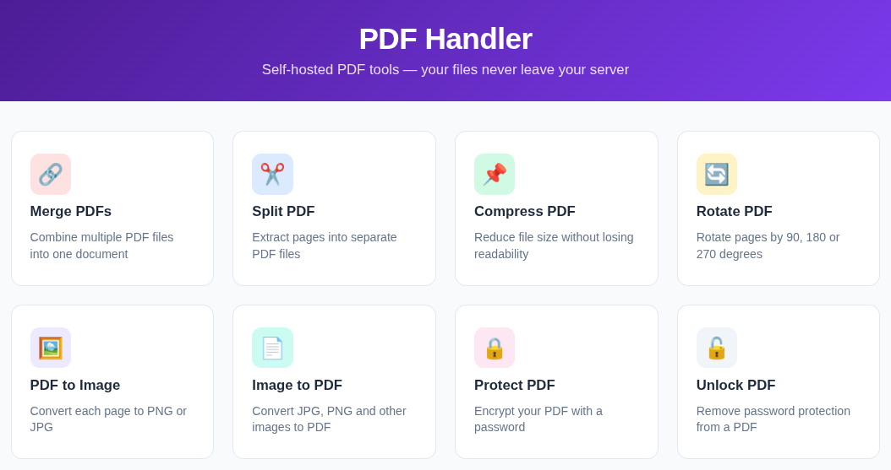

# PDF Handler

[](https://github.com/rafaelsilvabr/pdfHandler/actions/workflows/ci.yml)

A self-hosted PDF toolkit. One Go binary serves both the JSON API and a
self-contained web UI — no database, no object storage, no external service.
Files are processed in a temp directory and deleted when the response is sent.

Built for a homelab Kubernetes cluster, but it runs anywhere Docker does.



## Features

| Operation | What it does |
|---|---|
| **Merge** | Combine several PDFs into one |
| **Split** | Split by page count or custom ranges such as `1,3,6-7`, returned as a zip |
| **Cut** | Keep pages such as `1,3,6-7` together in a single PDF |
| **Compress** | Shrink a PDF at four quality levels (screen → prepress) |
| **Rotate** | Turn all pages or a selection by a multiple of 90° |
| **PDF → image** | Render pages to PNG or JPG at 72/150/300 dpi, returned as a zip |
| **Image → PDF** | Combine JPG/PNG/TIFF/WebP images into one PDF, one per page |
| **Protect** | Encrypt a PDF with a password |
| **Unlock** | Remove password protection |
| **Preview** | Page count plus base64 thumbnails, used by the UI |

The responsive workspace includes tool search (press `/`), category filters,
list and block layouts, keyboard-accessible page selection, and a compact
navigation menu on mobile. The top-bar toggle hides or restores the desktop
sidebar; layout and sidebar preferences are remembered in your browser.
In Merge PDFs, use the up/down arrows beside each selected file to set the
document order before merging. Files are combined from top to bottom.
In Split PDF, choose **Custom page ranges** and enter `1,3,6-7` to create three
PDFs: page 1, page 3, and pages 6–7 together. Each comma-separated entry creates
one PDF, in the entered order; unlisted pages are excluded. Overlapping or
repeated entries create separate files. The preview highlights included pages.
In Cut PDF, the same `1,3,6-7` selection produces a single four-page `cut.pdf`
containing pages 1, 3, 6, and 7. The entered order is preserved, and repeated
pages are included again. Both tools accept up to 1,000 entries; Cut PDF also
limits the output to 10,000 pages.
The About page at `/about` explains the project, file handling, and license.
It uses a warm cream palette, fine borders, and International Klein Blue
(`#002FA7`) for actions and selection. SF Pro is used when installed, with native
system fonts as fallbacks. All fonts, icons and UI assets stay local; no CDN or
frontend build step is required. Motion respects reduced-motion preferences.

## Quick start

```bash
docker run --rm -p 8080:8080 r4faelrs/pdfhandler:latest
```

Open <http://localhost:8080>.

### Kubernetes

```bash
kubectl apply -f k8s/
```

This creates the `pdfhandler-ns` namespace, a Deployment, a NodePort Service on
`30880`, and an nginx Ingress for `pdf.home.lab`. Adjust the hostname and the
image tag in `k8s/deployment.yaml` to match your cluster.

### Building from source

Requires Go 1.26+, plus `ghostscript` and `poppler-utils` on `PATH`:

```bash
go build -o pdfhandler .
./pdfhandler
```

Or build the container, which bundles both tools:

```bash
docker build -t pdfhandler .
```

## Configuration

| Variable | Default | Purpose |
|---|---|---|
| `PORT` | `8080` | Port to listen on |
| `MAX_UPLOAD_MB` | `100` | Maximum total upload request size in MiB (1 MiB = 1,048,576 bytes), including all files and multipart form overhead |
| `GIN_MODE` | `debug` | Set to `release` outside development |
| `HOME` | — | pdfcpu resolves its config dir from this; the image sets it to `/tmp` so it works as a non-root user |

Set the limit when starting the container, without rebuilding the image:

```bash
docker run --rm -p 8080:8080 -e MAX_UPLOAD_MB=250 pdfhandler
```

For Kubernetes, change `MAX_UPLOAD_MB` in `k8s/deployment.yaml`, or update an
existing Deployment (which rolls out new pods):

```bash
kubectl -n pdfhandler-ns set env deployment/pdfhandler MAX_UPLOAD_MB=250
kubectl -n pdfhandler-ns annotate ingress/pdfhandler-ingress \
  nginx.ingress.kubernetes.io/proxy-body-size=250m --overwrite
```

Keep the ingress or other reverse proxy's body limit at least as large as the
application limit; a smaller proxy limit rejects uploads before they reach the
app. Review memory and `/tmp` capacity when increasing it. Values must be positive
whole numbers; invalid or overflowing values prevent startup. Changes take effect
after a restart. The UI reads the active limit from `GET /api/config` and uses it
for the upload hints, About page, and file selection checks. UI labels use MB
for these binary units, matching the server's error messages.

## API

Operation endpoints take `multipart/form-data` and return the resulting file as
an attachment, except `/api/preview` (JSON). Configuration and health use GET.

| Endpoint | Form fields | Returns |
|---|---|---|
| `GET /api/config` | — | JSON: `maxUploadBytes` (active request body limit) |
| `POST /api/merge` | `files[]` (2–50 PDFs) | `merged.pdf` |
| `POST /api/split` | `file`, either `span` (pages per chunk, default 1) or `pages` (`1,3,6-7`; one PDF per entry, max 1,000 entries) | `split.zip` |
| `POST /api/cut` | `file`, `pages` (`1,3,6-7`; required, up to 1,000 entries and 10,000 output pages) | `cut.pdf` |
| `POST /api/compress` | `file`, `quality` (`screen`\|`ebook`\|`printer`\|`prepress`) | `compressed.pdf` |
| `POST /api/rotate` | `file`, `degrees` (multiple of 90), `pages` (`all` or `1,3,5-7`) | `rotated.pdf` |
| `POST /api/pdf-to-image` | `file`, `format` (`png`\|`jpg`), `dpi` (`72`\|`150`\|`300`) | `images.zip` |
| `POST /api/image-to-pdf` | `files[]` (1–100 images) | `output.pdf` |
| `POST /api/protect` | `file`, `password` | `protected.pdf` |
| `POST /api/unlock` | `file`, `password` | `unlocked.pdf` |
| `POST /api/preview` | `file`, `limit` (max 50) | JSON: page count + thumbnails |
| `GET /healthz` | — | `{"status":"ok"}` |

Errors come back as `{"error": "..."}` with a 4xx or 5xx status.

```bash
curl -F "files[]=@a.pdf" -F "files[]=@b.pdf" \
     -o merged.pdf http://localhost:8080/api/merge

curl -F "file=@big.pdf" -F "quality=screen" \
     -o small.pdf http://localhost:8080/api/compress

curl -F "file=@big.pdf" -F "pages=1,3,6-7" \
     -o split.zip http://localhost:8080/api/split

curl -F "file=@big.pdf" -F "pages=1,3,6-7" \
     -o cut.pdf http://localhost:8080/api/cut
```

## Security

Every endpoint hands an untrusted file to ghostscript, poppler or pdfcpu, so
requests are narrowed before any of that runs:

- Uploads must start with the `%PDF-` magic bytes; image uploads must carry an
  allow-listed extension, derived from `filepath.Base` and pattern-matched
  rather than taken from `filepath.Ext` directly.
- Parameters are validated and rejected, not coerced.
- The request body is capped via `http.MaxBytesReader` (100 MiB by default,
  configurable with `MAX_UPLOAD_MB`); oversize
  uploads get a 413.
- Each ghostscript/poppler run is bounded by a 90 s timeout tied to the request
  context, and ghostscript runs with `-dSAFER`.
- Tool output and pdfcpu errors go to the log, never the response — they embed
  temp paths and fragments of the uploaded document.
- Responses carry a CSP and the usual hardening headers; `POST` responses are
  `no-store`.
- The container runs as a non-root user with a read-only root filesystem, all
  capabilities dropped, and no ServiceAccount token.

`go build` is checked against `govulncheck` — no known advisories reach this
code outside the standard library.

### Known limitations

- **No authentication.** Anyone who can reach the port can use it. Put it behind
  your ingress' auth, a VPN, or a trusted network.
- **The sample Ingress serves plain HTTP.** `/api/protect` and `/api/unlock`
  carry passwords in the request body, so terminate TLS before exposing it
  beyond a trusted LAN — `k8s/ingress.yaml` has a commented block for this.
- **No rate limiting.** Per-request timeouts and the CPU limit bound each job,
  but many concurrent compressions can still saturate a node.

## How it works

Gin routes both the API and the static UI from a single binary. Operations that
pdfcpu handles natively (merge, split, cut, rotate, encrypt, image import) run
in-process; compression shells out to ghostscript and rasterisation to poppler's
`pdftoppm`, since neither has a good pure-Go equivalent.

See [DESIGN.md](DESIGN.md) for the reasoning behind those choices, the
alternatives considered, and the Kubernetes design.

```
main.go              Routing, middleware, server timeouts
handlers/            One file per operation; util.go holds the shared
                     validation, sandboxing and error helpers
static/index.html    Workspace markup and tool option panels
static/styles.css    Design tokens, responsive layouts and interaction states
static/app.js        Tool catalog, navigation, uploads, previews and processing
k8s/                 Namespace, Deployment, Service, Ingress
```

## Contributing

For bug reports, feature requests, development setup, tests, and pull requests,
see the [contribution guide](contribute.md).

Report vulnerabilities through [private vulnerability reporting](https://github.com/rafaelsilvabr/pdfHandler/security/advisories/new).

## Built with

[Gin](https://github.com/gin-gonic/gin) ·
[pdfcpu](https://github.com/pdfcpu/pdfcpu) ·
[Ghostscript](https://www.ghostscript.com/) ·
[Poppler](https://poppler.freedesktop.org/)

## License

MIT — see [LICENSE](LICENSE).
